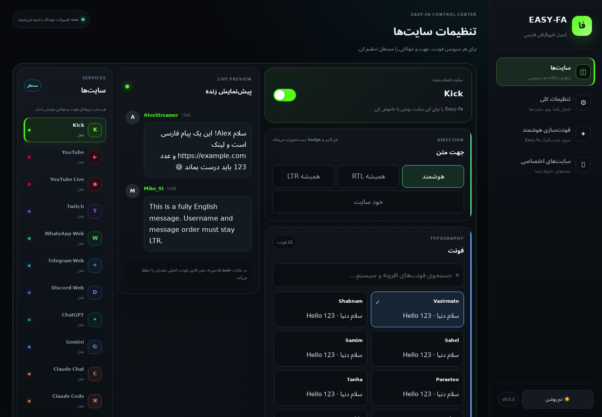
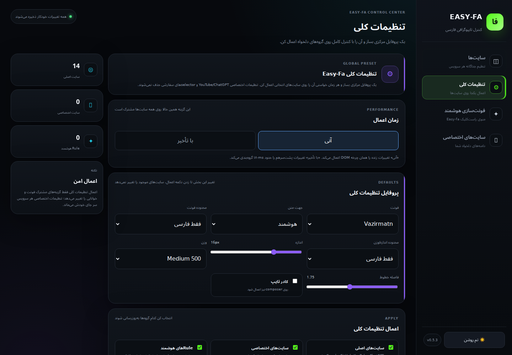
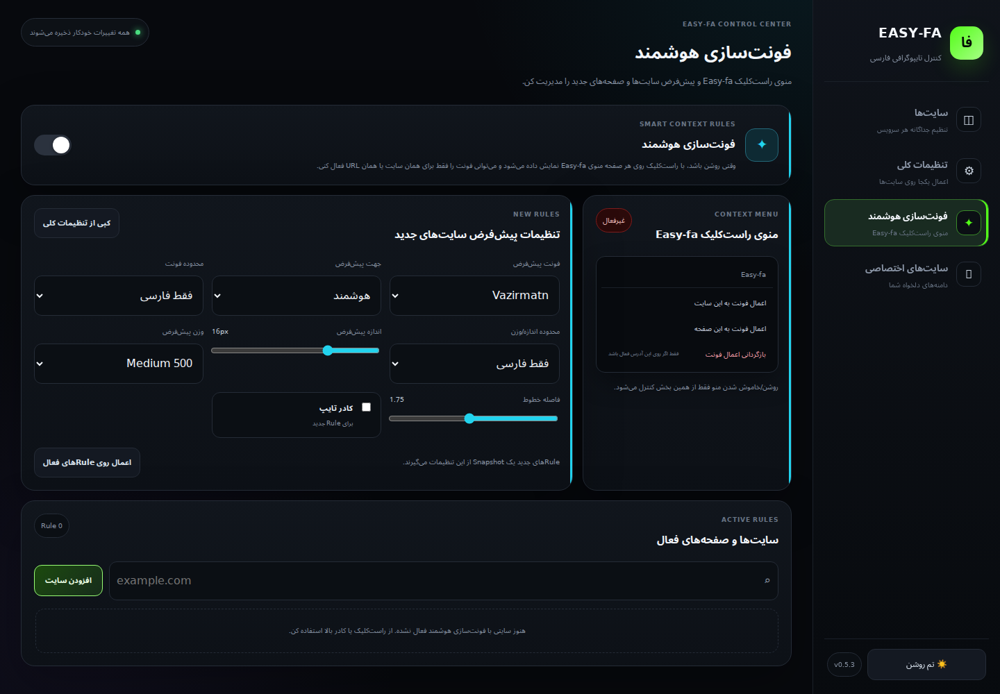

# Easy-Fa — گالری دمو

[README فارسی](../README.fa.md) · [English](../README.md)

رابط اصلی تنظیمات با آداپتور آزمایشی Chrome API و حافظهٔ موقت ثبت شده است؛ این تصاویر اجرای اعمال فونت روی وب‌سایت‌ها را نشان نمی‌دهند.

## پروفایل وب‌سایت‌ها

## تنظیمات عمومی

## ساخت هوشمند فونت

